<div align="center">

# Cloud-Native EKS Auto-Scaling Platform

**A containerized application on AWS, run by Kubernetes on Amazon EKS, exposed through an Application Load Balancer, and scaled by a Horizontal Pod Autoscaler.**


[Architecture](#architecture) |
[Deployment Guide](#deployment-guide) |
[Screenshots](#screenshots) |
[Results](#testing-and-results) |
[Limitations](#limitations)

</div>

---

## Project at a Glance

| | |
|---|---|
| **Goal** | Run a containerized website on Kubernetes in AWS and show load balancing, self-healing and CPU-based Pod autoscaling |
| **Student** | Shree Dhadge, B.Sc. Cloud Computing |
| **Region** | Asia Pacific (Mumbai) `ap-south-1` |
| **Cluster** | Amazon EKS, managed node group of 2 x `t3.medium` (Amazon Linux 2023) |
| **Application** | Static frontend (HTML, CSS, JavaScript) served by Nginx in a Docker container |
| **Replicas** | 2 Pods at start; HPA range 2 to 6 Pods at a 50% CPU target |
| **Infrastructure as Code** | AWS CloudFormation (`vpc.yaml`, `eks.yaml`) |
| **Image build** | AWS CodeBuild, image stored in Amazon ECR |
| **Traffic entry** | Internet-facing Application Load Balancer created from a Kubernetes Ingress |

## Table of Contents

1. [Key Features](#key-features)
2. [Architecture](#architecture)
3. [Technology Stack](#technology-stack)
4. [Repository Structure](#repository-structure)
5. [Kubernetes Manifests Explained](#kubernetes-manifests-explained)
6. [Deployment Guide](#deployment-guide)
7. [Screenshots](#screenshots)
8. [Testing and Results](#testing-and-results)
9. [Security Considerations](#security-considerations)
10. [Limitations](#limitations)
11. [Roadmap](#roadmap)
12. [Cost and Cleanup](#cost-and-cleanup)
13. [Lessons Learned](#lessons-learned)
14. [Author](#author)

## Key Features

- **Containerized frontend:** a Docker image based on `nginx:alpine`, identical on every node.
- **Managed Kubernetes:** Amazon EKS runs the control plane; two EC2 worker nodes in two Availability Zones run the Pods.
- **Load balancing:** the AWS Load Balancer Controller turns a Kubernetes Ingress into an Application Load Balancer that sends traffic to the Pods.
- **Self-healing:** the Deployment keeps the desired number of Pods running and replaces failed ones.
- **Autoscaling configuration:** a Horizontal Pod Autoscaler (2 to 6 Pods, 50% CPU target) driven by Metrics Server, with CPU requests and limits set on the containers.
- **Infrastructure as Code:** the network, cluster, node group, IAM roles and ECR repository are created from CloudFormation templates, with no Terraform.
- **Automated image build:** AWS CodeBuild builds the Docker image from GitHub and pushes it to Amazon ECR, tagged with the commit ID and `latest`.
- **Live status panel:** the website shows a real HTTP status, response time and server name for the request it just made.

## Architecture


*Architecture as deployed. The diagrams below show the same design in text-based form.*

### Runtime architecture

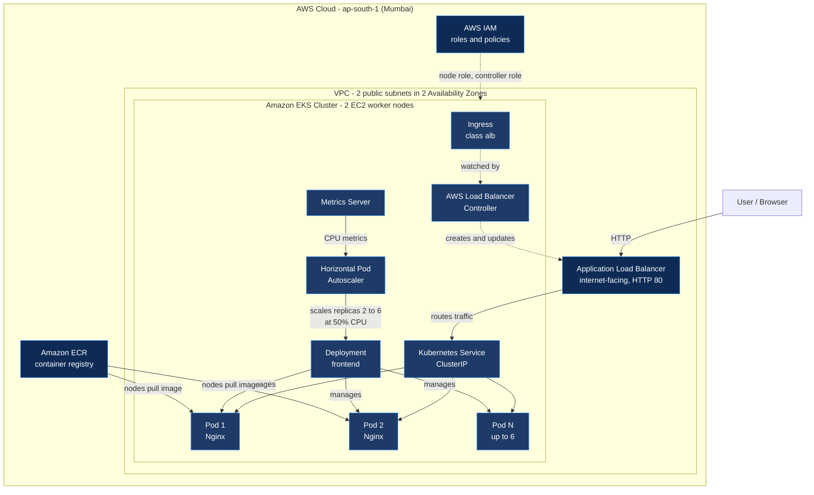

> The ALB uses `target-type: ip`, so it sends requests directly to Pod IP addresses. The Service is shown in the path as the logical entry point that selects the Pods.

### Build and deployment pipeline

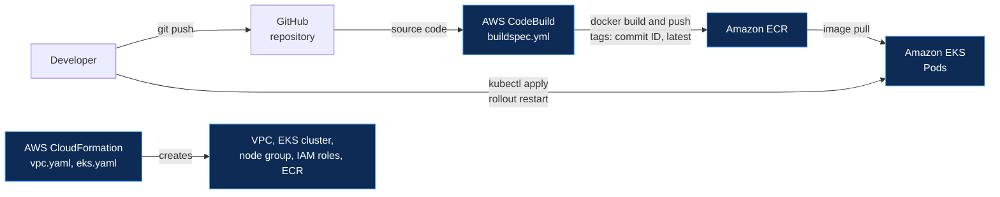

### Request flow

1. A user opens the load balancer address in a browser (HTTP).
2. The Application Load Balancer, created from the Ingress, receives the request and forwards it to a healthy Pod target.
3. One of the frontend Pods, running Nginx, returns the website files.
4. Metrics Server reports CPU usage; the HPA changes the replica count when usage crosses the 50% target.

### Design decisions

| Decision | Reason |
|---|---|
| **Public subnets for nodes** | Avoids NAT Gateway cost in a learning project. See [Limitations](#limitations). |
| **CloudFormation, not Terraform** | Native AWS tooling, and the project requirement. |
| **EKS API limited to one `/32` IP** | The public endpoint is never open to `0.0.0.0/0`. Private endpoint access is also enabled so worker nodes can still reach the API from inside the VPC. |
| **CodeBuild for images** | Builds happen in AWS and the image goes straight to ECR, so no local Docker is needed. |
| **ClusterIP Service + Ingress** | The load balancer is created by the Ingress, so the Service does not need its own cloud load balancer. |
| **`t3.medium` nodes** | Gives room for more Pods per node than smaller instance types. |

## Technology Stack

| Area | Technology |
|---|---|
| Cloud | Amazon Web Services |
| Container platform | Amazon EKS (Kubernetes) |
| Compute | Amazon EC2 managed node group |
| Container | Docker, Nginx (alpine) |
| Registry | Amazon ECR |
| Build | AWS CodeBuild |
| Infrastructure as Code | AWS CloudFormation |
| Networking | Amazon VPC, Internet Gateway, route tables, Security Groups |
| Ingress | AWS Load Balancer Controller, Application Load Balancer |
| Scaling | Kubernetes HPA, Metrics Server |
| Access control | AWS IAM roles and policies |
| Source control | Git, GitHub |

## Repository Structure

```text
cloud-native-eks-auto-scaling-platform/
├── Architecture/            # Architecture diagram image
├── cloudformation/          # Infrastructure as Code
│   ├── vpc.yaml             #   VPC, 2 public subnets, Internet Gateway, routes
│   ├── eks.yaml             #   EKS cluster, node group, IAM roles, ECR repository
│   └── README.md            #   Parameters and troubleshooting
├── docker/
│   └── Dockerfile           # nginx:alpine image for the frontend
├── frontend/                # Website: index.html, style.css, script.js
├── k8s/                     # Kubernetes manifests
│   ├── deployment.yaml
│   ├── service.yaml
│   ├── ingress.yaml
│   └── hpa.yaml
├── screenshots/             # Deployment and test evidence
├── buildspec.yml            # AWS CodeBuild build instructions
└── README.md
```

## Kubernetes Manifests Explained

| File | Kind | What it does |
|---|---|---|
| `k8s/deployment.yaml` | Deployment | Runs 2 replicas of the frontend image, with CPU and memory requests and limits, plus readiness and liveness probes. The image address is a placeholder that is filled in at deploy time. |
| `k8s/service.yaml` | Service (ClusterIP) | Gives the Pods one stable internal address on port 80. |
| `k8s/ingress.yaml` | Ingress (class `alb`) | Asks the AWS Load Balancer Controller to create an internet-facing Application Load Balancer. |
| `k8s/hpa.yaml` | HorizontalPodAutoscaler | Keeps between 2 and 6 Pods, targeting 50% average CPU utilization. |

CPU utilization for the HPA is measured against each container's CPU **request**, so the Deployment must define one.

## Deployment Guide

**Prerequisites:** an AWS account, AWS CLI v2, `kubectl`, Helm, `eksctl`, Git. Run the commands in Git Bash (Windows) or any Linux/macOS shell, from the repository root, with region `ap-south-1`.

### 1. Create the network

CloudFormation, then Create stack, upload `cloudformation/vpc.yaml`, stack name `eks-autoscale-vpc`.

### 2. Create the cluster

Upload `cloudformation/eks.yaml` as stack `eks-autoscale-eks`. Set `KubernetesVersion` to a version currently in standard support and `MyIpCidr` to your public IP with `/32`. Acknowledge the IAM capability. This takes roughly 15 to 25 minutes.

### 3. Connect kubectl

```bash
aws eks update-kubeconfig --region ap-south-1 --name eks-autoscale-cluster
kubectl get nodes
```

### 4. Build and push the image

Create a CodeBuild project from this GitHub repository with privileged mode enabled, give its role permission to push to the ECR repository, then start a build. The image is tagged with the commit ID and `latest`.

### 5. Install Metrics Server

```bash
kubectl apply -f https://github.com/kubernetes-sigs/metrics-server/releases/latest/download/components.yaml
kubectl top nodes
```

### 6. Install the AWS Load Balancer Controller

Follow the current AWS guide: associate the cluster OIDC provider, create the controller IAM policy and service account, then install the Helm chart `eks/aws-load-balancer-controller` with your cluster name, region and VPC ID.

### 7. Deploy the application

```bash
ACCOUNT_ID=$(aws sts get-caller-identity --query Account --output text)
IMAGE=$ACCOUNT_ID.dkr.ecr.ap-south-1.amazonaws.com/cloud-native-eks-frontend:latest
sed "s|IMAGE_URI_PLACEHOLDER|$IMAGE|" k8s/deployment.yaml | kubectl apply -f -
kubectl apply -f k8s/service.yaml -f k8s/ingress.yaml -f k8s/hpa.yaml
kubectl get ingress
```

Open `http://<ingress-address>` in a browser.

### 8. Update the application

```bash
git push origin main                      # then start the CodeBuild build
kubectl rollout restart deployment/frontend
kubectl rollout status deployment/frontend
```

## Screenshots

### Application

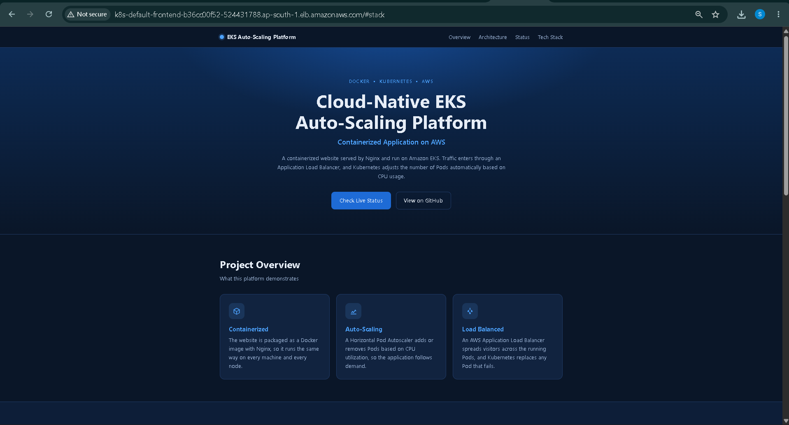
*The website served over HTTP through the AWS Application Load Balancer.*

<!-- ADD after capturing: Application Status section showing Online, response time and nginx
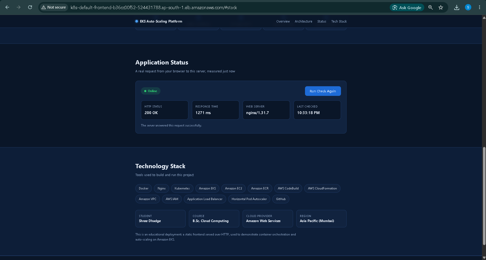
*The status panel reports a live HTTP status, response time and web server name.*
-->

### Kubernetes

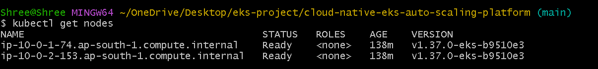
*Two EKS worker nodes in `Ready` state.*

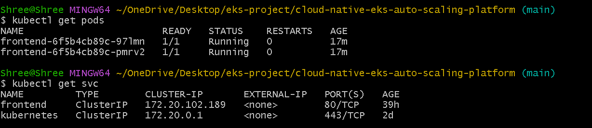
*Two frontend Pods `Running`, exposed by a ClusterIP Service.*

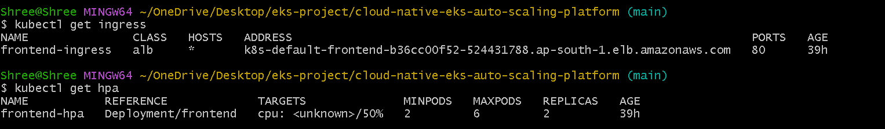
*The Ingress with its load balancer address, and the Horizontal Pod Autoscaler (min 2, max 6, 50% CPU target).*

<!-- ADD after capturing: kubectl top nodes

*Metrics Server reporting node CPU and memory usage.*
-->

<!-- ADD after capturing: Load Balancer Controller

*AWS Load Balancer Controller deployment ready in kube-system.*
-->

### AWS infrastructure

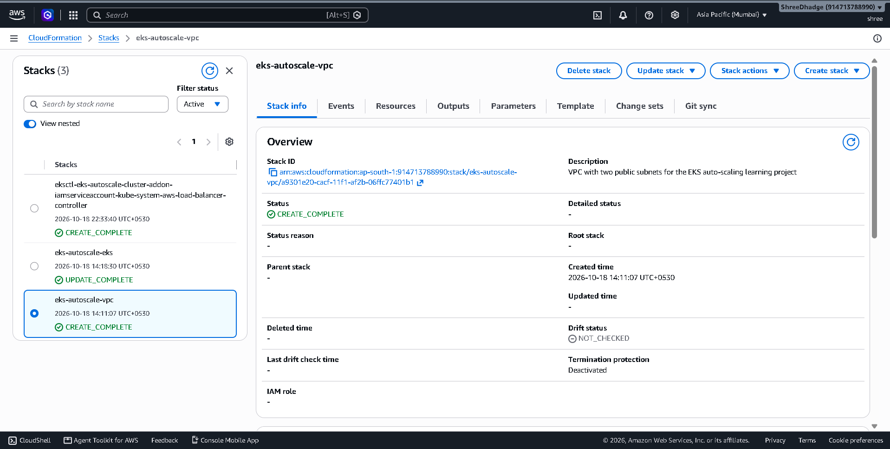
*CloudFormation stacks for the VPC, the EKS cluster and the load balancer controller service account.*

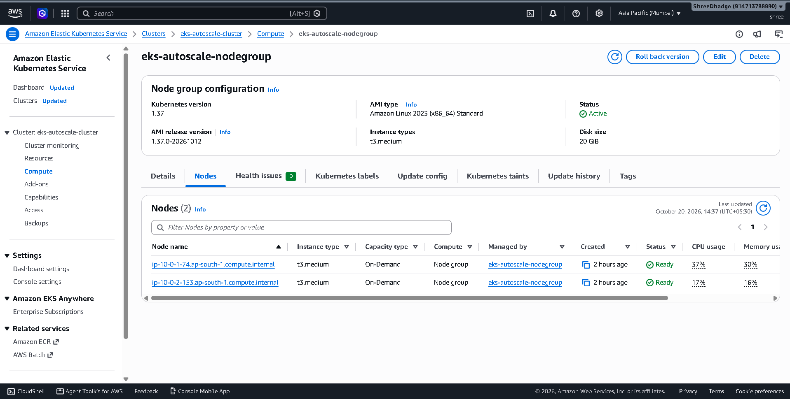
*The managed node group is Active, with 2 `t3.medium` nodes Ready.*

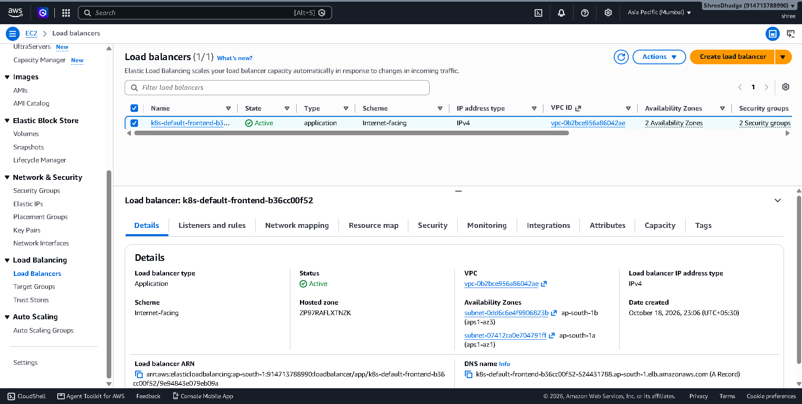
*An internet-facing Application Load Balancer, Active across 2 Availability Zones.*

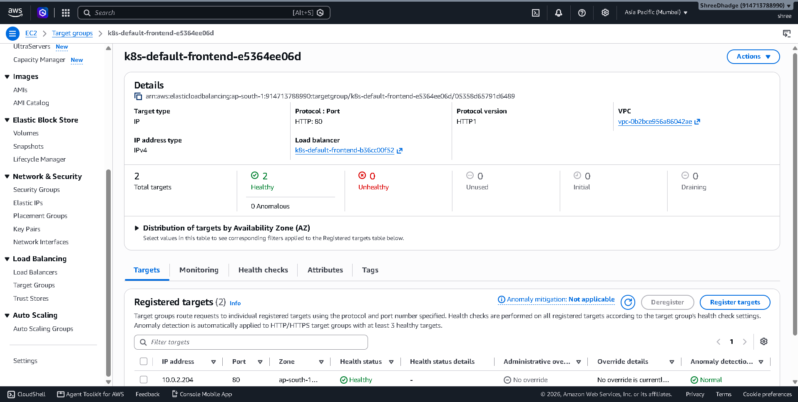
*The target group shows 2 of 2 Pod targets healthy.*

### Build pipeline

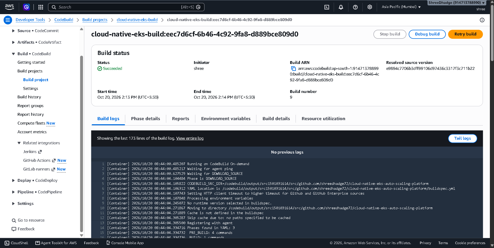
*AWS CodeBuild building the Docker image from GitHub (build Succeeded).*

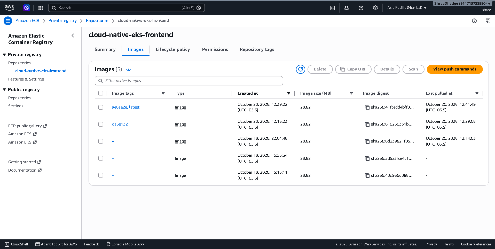
*Images stored in Amazon ECR, tagged by commit ID and `latest`.*

### Resilience and scaling tests

<!-- ADD after capturing: self-healing test

*One Pod was deleted; Kubernetes created a replacement while the site stayed available.*
-->

<!-- ADD after capturing: HPA scaling test

*The HPA increased the Pod count while load was generated.*
-->

## Testing and Results

Only results that were observed are listed.

| Test | How it was checked | Result |
|---|---|---|
| Website reachable | Opened the load balancer address in a browser | The site loads over HTTP |
| Cluster health | `kubectl get nodes`, EKS console | 2 nodes `Ready`, node group `Active` |
| Application Pods | `kubectl get pods` | 2 Pods `Running`, 0 restarts |
| Load balancer health | EC2 target group | 2 of 2 targets healthy |
| Image pipeline | CodeBuild and ECR consoles | Build succeeded; image pushed to ECR |
| Infrastructure creation | CloudFormation | VPC and EKS stacks complete |

<!-- ADD these rows once the tests are done and the numbers are real:
| Self-healing | Deleted one Pod with `kubectl delete pod` | FILL: result you saw |
| Autoscaling | Generated load with a busybox wget loop | FILL: Pod count before and after, and the CPU shown by the HPA |
-->

## Security Considerations

**In place**

- The public EKS API endpoint is restricted to one IP address (`/32`), never `0.0.0.0/0`.
- Separate IAM roles for the cluster and the worker nodes, using AWS managed policies; the load balancer controller uses its own IAM role through a service account.
- The CodeBuild role is limited to pushing to the one ECR repository.
- ECR image scanning on push is enabled, and old images are removed by a lifecycle policy.
- No credentials, keys or account IDs are stored in the repository; the image address is filled in at deploy time.

**Not in place** (see [Limitations](#limitations)): HTTPS, private subnets for nodes, network policies.

## Limitations

This is a learning deployment, not a production-ready system.

- **Public subnets:** worker nodes have public IPs and are protected by security groups only. Production should use private subnets with a NAT Gateway or VPC endpoints.
- **HTTP only:** HTTPS needs a domain name and an ACM certificate, which were not configured.
- **Pods scale, nodes do not:** the HPA changes the number of Pods only. Scaling nodes needs Cluster Autoscaler or Karpenter, which are not used.
- **Single-IP API access:** the EKS API accepts one IP, so it must be updated when that IP changes, and automated tools running elsewhere cannot reach it.
- **Manual deployment:** builds and rollouts are started by hand; there is no automatic CD pipeline.
- **Static application:** the frontend has no backend or database.

## Roadmap

- [ ] CodeBuild webhook for automatic builds on every push
- [ ] Deploy images by commit ID instead of `latest`
- [ ] GitOps deployment with Argo CD
- [ ] HTTPS with a custom domain and ACM certificate
- [ ] Private subnets for worker nodes
- [ ] Cluster Autoscaler or Karpenter for node scaling
- [ ] CloudWatch Container Insights dashboards and alarms
- [ ] Backend API with a managed database

## Cost and Cleanup

The EKS control plane, EC2 nodes and the load balancer are billed per hour while they exist. After finishing, delete in this order:

1. `kubectl delete -f k8s/ingress.yaml` and wait for the load balancer to disappear.
2. `kubectl delete -f k8s/hpa.yaml -f k8s/service.yaml -f k8s/deployment.yaml`
3. `helm uninstall aws-load-balancer-controller -n kube-system`
4. CloudFormation: delete the `eksctl-...-iamserviceaccount` stack, then `eks-autoscale-eks`, then `eks-autoscale-vpc`.
5. Delete the controller IAM policy, and the CodeBuild project and its role.

## Lessons Learned

- **API access and IP addresses:** `kubectl` timed out because the EKS API only allowed one IP address. Checking the allowed range with `aws eks describe-cluster` and updating `MyIpCidr` through the CloudFormation stack fixed it.
- **Private and public endpoint together:** with the public endpoint limited to one IP, private endpoint access must stay enabled so worker nodes can reach the API.
- **Rolling out new images:** the running Pods keep the old image until the Deployment is restarted, so every image build is followed by `kubectl rollout restart`.
- **Keep Git and the cluster in sync:** manifests that exist only on the local machine are not what the reviewers see on GitHub.

## Author

**Shree Dhadge**, B.Sc. Cloud Computing
GitHub: [@shreedhadge72](https://github.com/shreedhadge72)

---

<div align="center">
<sub>Docker | Kubernetes | AWS</sub>
</div>
